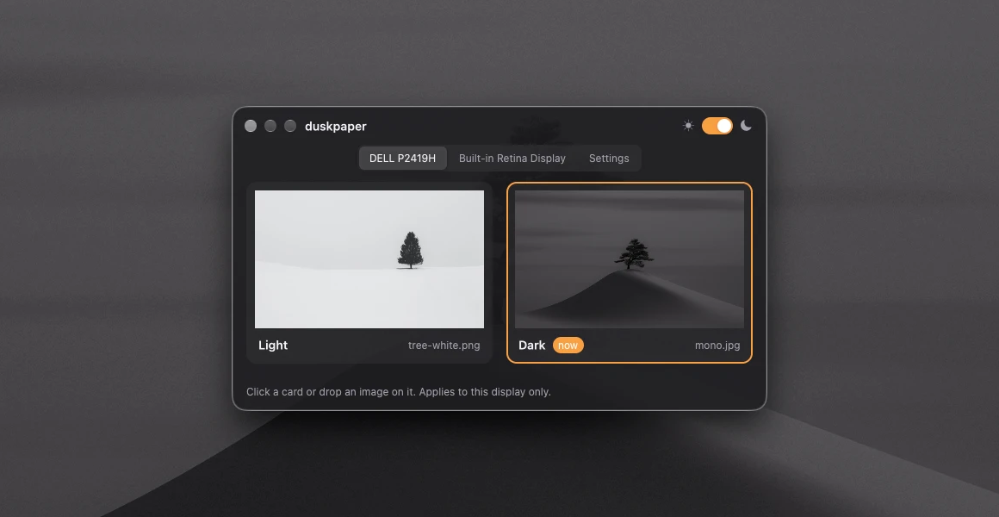

# duskpaper

One wallpaper for Light mode, one for Dark. duskpaper switches between them
when macOS does.



A small menu bar app written in Rust with [GPUI](https://gpui.rs).

- Follows manual switches and Auto (sunrise / sunset)
- Separate images per display
- Click or drop an image on a card; HEIC works
- Flip Light/Dark from the window or the menu bar
- Starts at login, no Dock icon

## Build

Requires macOS, Rust, and the Xcode Command Line Tools.

```sh
./bundle.sh
open target/duskpaper.app
```

## CLI

The same binary works headless.

```sh
duskpaper set ~/day.jpg ~/night.jpg   # all displays, applies now
duskpaper status                      # current mode and images
duskpaper apply                       # apply once
duskpaper watch                       # follow changes in the foreground
duskpaper install                     # start at login
duskpaper uninstall
```

Config lives in `~/.config/duskpaper/config`:

```ini
light=/Users/me/Pictures/day.jpg
dark=/Users/me/Pictures/night.jpg
dark@Built-in Retina Display=/Users/me/Pictures/night-laptop.jpg
```

## Notes

macOS only sets the wallpaper on the active Space. duskpaper re-applies when
you switch Spaces or wake the Mac, so other Spaces catch up on first visit.
